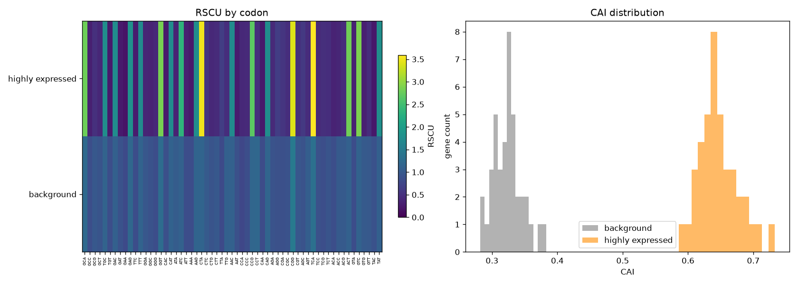

# codon-usage-bias-analyzer

Not all synonymous codons are created equal. The ribosome has preferences, the tRNA pool has preferences, and evolution has quietly baked those preferences into the genes you care about most.

This repo computes **codon usage frequencies**, **Relative Synonymous Codon Usage (RSCU)**, and the **Codon Adaptation Index (CAI)** so you can quantify how strongly a gene's codon choices track the organism's translationally optimal codons.

## Demo Output



The figure above was produced from simulated data by `demo.py`, contrasting an RSCU heatmap with the CAI distributions of synthetic 'highly expressed' and 'background' gene sets.

## Why This Exists

Codon usage bias is one of those signals that is cheap to compute and surprisingly informative. It shows up in:

- predicting which genes are translationally optimised
- designing synthetic constructs for heterologous expression
- spotting horizontally transferred genes that have not yet 'ameliorated'

Most people reach for a heavyweight tool, run it once, and never look at the maths. This project keeps the maths visible and the code small.

## The Method In Three Steps

1. **Count codons** per gene, grouped by the amino acid they encode.
2. **RSCU**: for each codon, the observed frequency divided by the frequency expected if all synonymous codons were used equally. RSCU = 1 means no bias; > 1 means over-used.
3. **CAI**: build a reference set of relative adaptiveness weights (w) from a 'highly expressed' gene set, then score every gene as the geometric mean of the weights of its codons.

## Quick Start

```bash
pip install -r requirements.txt
python demo.py            # self-contained, writes figures/ and results/
python codon_bias.py --fasta your_cds.fasta --reference highexp.fasta
```

## When NOT to Use This

| Situation | Use this? | Better option |
|-----------|-----------|---------------|
| Comparing codon bias across genes in one genome | Yes | - |
| Sequences that are not in-frame CDS | No | Annotate ORFs first |
| You lack a credible highly-expressed reference set | Careful | Use tRNA adaptation index (tAI) instead |
| Very short genes (< 100 codons) | No | CAI is noisy; aggregate first |

## The Uncomfortable Truth

CAI is only as good as the reference set you feed it. If your 'highly expressed' genes are poorly chosen, you are measuring your own assumptions, not biology. RSCU and CAI also confound mutational pressure (GC content) with selection for translational efficiency. Always sanity-check against GC3 before you claim adaptation.

## Further Reading

- "The codon adaptation index - a measure of directional synonymous codon usage bias" by Paul M. Sharp and Wen-Hsiung Li
- "Codon usage in regulatory genes in Escherichia coli does not reflect selection for rare codons" by Paul M. Sharp and others
- "Codon usage bias: causative factors, quantification methods and genome-wide patterns" by Zoltan Gingold and Juan Pablo Tosar
